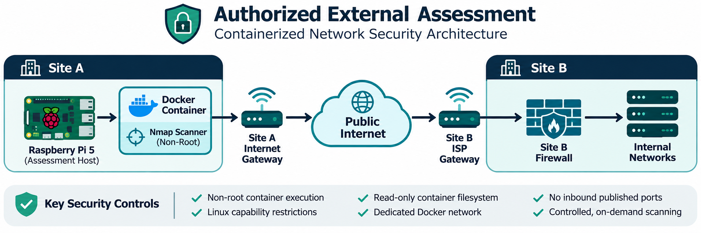
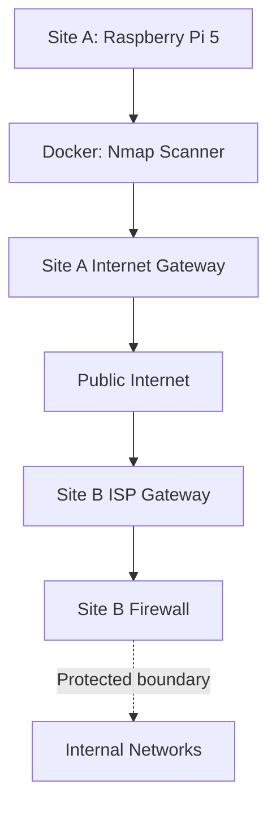

# External Scanner Architecture

*Illustrative topology only; no internal access was demonstrated by the initial assessment.*

## Purpose

Assess authorized external network exposure from a
separate internet-connected site without deploying
scanning tools directly onto the target network.

## Architecture

> The diagram represents the network topology.
It does not imply that external scan traffic
successfully reached internal networks.
## Scanner Security Controls

| Control | Implementation |
|---|---|
| Execution | Non-root UID 10001 |
| Linux capabilities | All dropped |
| Privilege escalation | Disabled |
| Root filesystem | Read-only |
| Networking | Dedicated Docker bridge |
| Inbound ports | None published |
| Reports | Dedicated writable directory |
| Execution | On demand |
| Memory limit | Configured; not enforced |

## Operational Considerations

The scanner shares its physical host with production
services. Container isolation reduces risk but does
not provide complete host isolation.

Memory cgroups are currently disabled on the host.
Remediation requires planned maintenance.

Raw assessment reports and internal network details
are excluded from this public repository.
